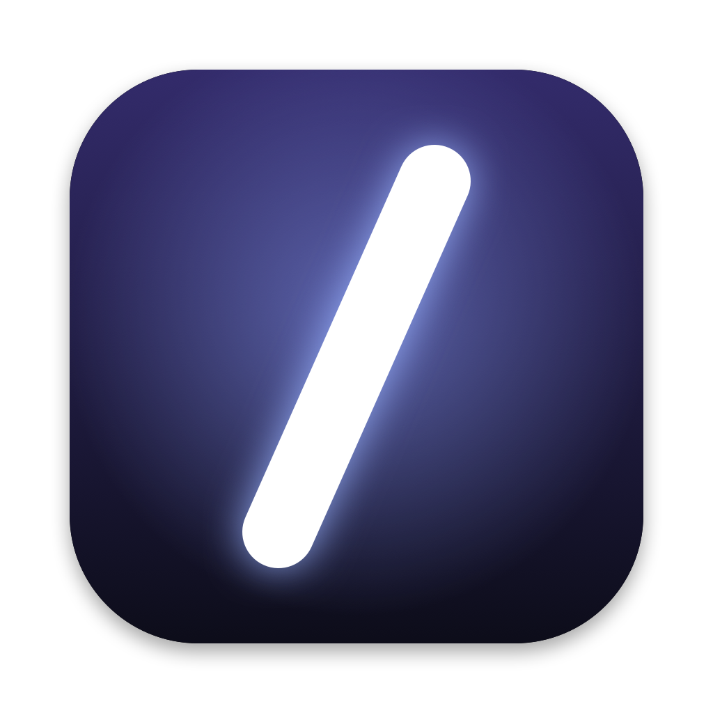
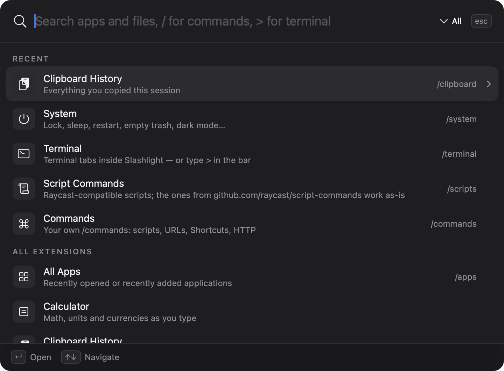
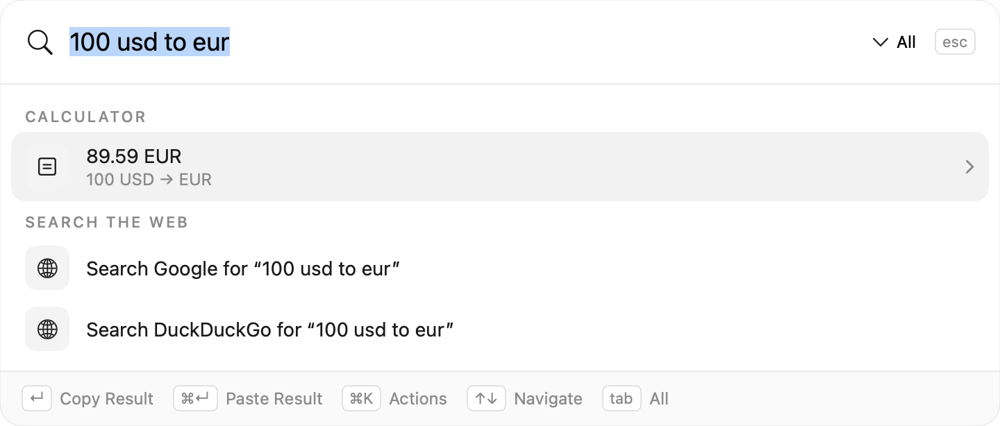
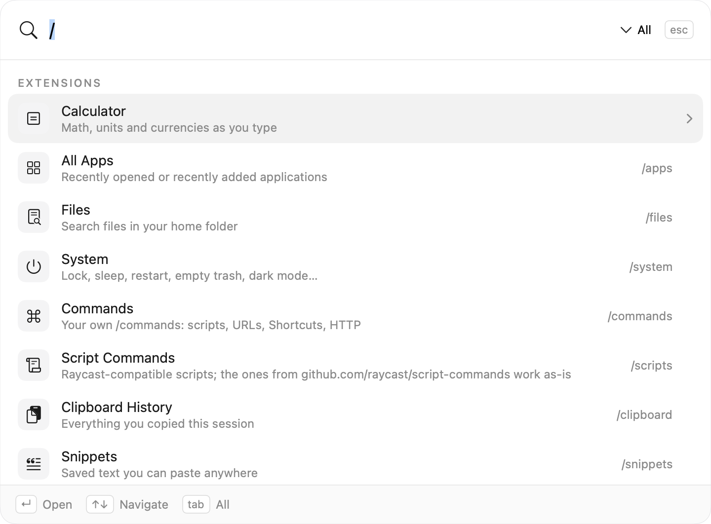
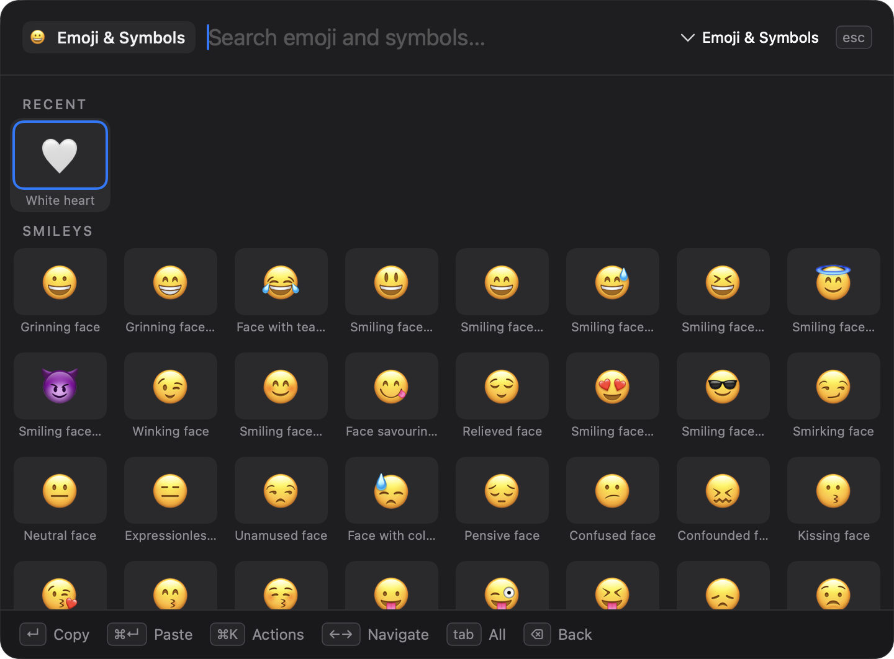
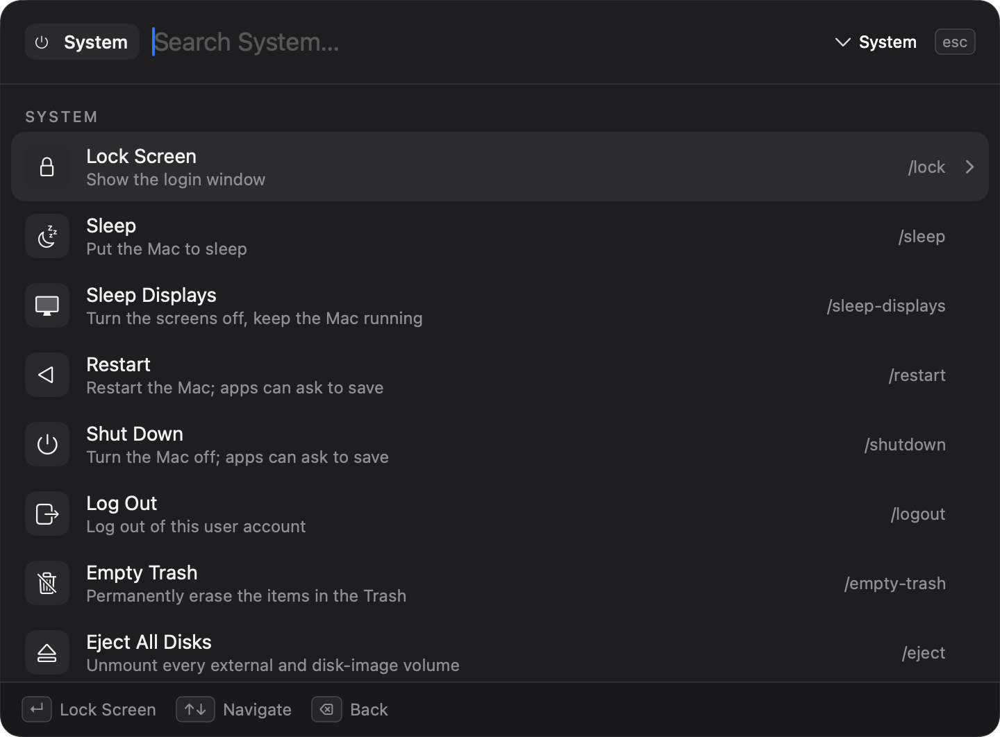
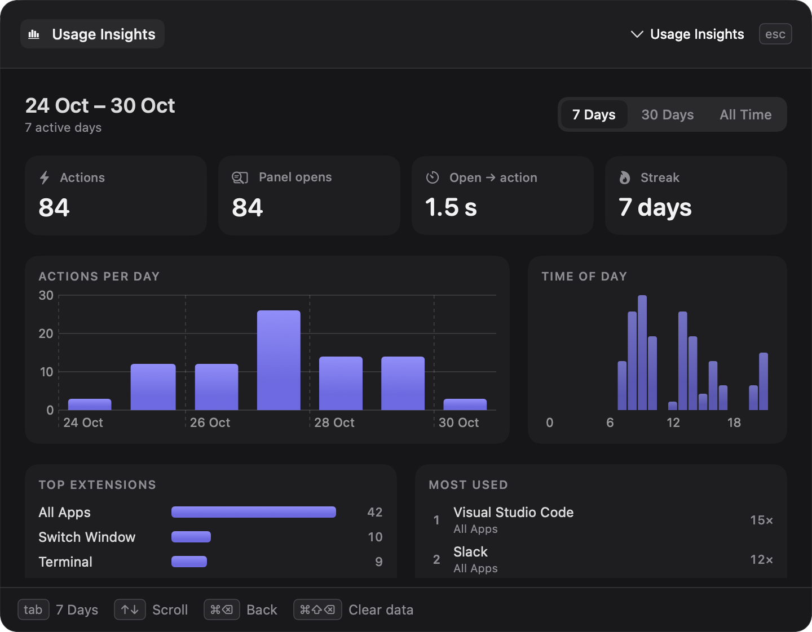
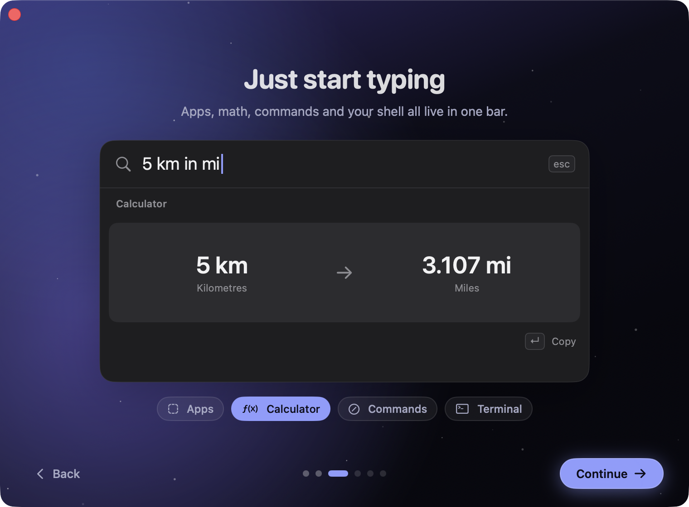

<div align="center">



# Slashlight

**A keyboard-first launcher for macOS. Open-source, native, and built to be extended.**

Apps, files, windows on every Space, a calculator, snippets, clipboard history and real terminal tabs, all one shortcut away.

[](https://github.com/burinworks/slashlight/actions/workflows/ci.yml)
[](https://github.com/burinworks/slashlight/releases)
[](LICENSE)




</div>

## Why Slashlight

- **Native and fast.** AppKit + SwiftUI, no Electron and no web views. The panel is built at launch and opens instantly.
- **Everything is an extension.** The built-ins use the same public `Extension` API you do. There is no private fast path.
- **Crash-proof plugins.** Third-party extensions run as separate processes speaking JSON over stdin/stdout, in any language.
- **Raycast-friendly.** Raycast [script commands](https://github.com/raycast/script-commands) run unchanged.
- **Yours.** MIT licensed, no account, no telemetry. Config is plain JSON in `~/Library/Application Support/Slashlight/`.

## Features

| | |
|---|---|
|  | **Calculator as you type.** Math (`(3+4)*2^3`, `15% of 80`), units (`5 km in mi`, `100 f to c`) and live currency rates (`100 usd to eur`). ↵ copies, ⌘↵ pastes. |
|  | **Command mode.** Type `/` for every extension and your own commands: shell scripts, URLs with `{query}` quicklinks, Shortcuts, HTTP calls and AppleScript. |
|  | **Emoji & symbols.** A searchable grid with recents first, plus ⌘ ⌥ → © and friends. |
|  | **System commands.** Lock, sleep, restart, empty trash, eject disks, toggle dark mode, quit all apps. |
|  | **Usage Insights.** `/insights` shows what you use most, when you're busiest, your streak and how fast you get from opening the panel to an action. The data stays on your Mac. |
|  | **Welcome tour.** On first launch, six short steps set your hotkey (with help freeing ⌘Space from Spotlight), show what you can type and where extensions live, and offer the two optional permissions. |

Also built in:

- **Window switcher** (⌥Tab). Thumbnails of every window on every Space and display, including minimized windows and hidden apps.
- **Window layouts.** Halves, thirds, quarters, center and maximize on ⌃⌥ + arrow keys and letters.
- **Terminal tabs.** `> npm run dev` opens a real terminal inside the panel. It keeps running when you go back to search, and a tab strip shows which tasks are busy, idle or failed.
- **Clipboard history, snippets** (multi-line, with `{clipboard}` `{date}` `{time}` placeholders), **file search** and **web search fallback**.
- **Settings window.** Hotkey recorder, light/dark theme, launch at login, per-extension on/off switches and permission status.

The [user guide](docs/user-guide.md) has every key and command.

## Install

### Download

1. Download `Slashlight-vX.Y.Z.dmg` from [Releases](https://github.com/burinworks/slashlight/releases), open it and drag Slashlight to Applications.
2. The app is not notarized by Apple, so clear the quarantine flag once:
   ```bash
   xattr -dr com.apple.quarantine /Applications/Slashlight.app
   ```
3. Open it and press **⌥Space**. The app lives in the menu bar.
4. Grant **Accessibility** (window layouts, paste) and **Screen Recording** (window thumbnails) from Settings (⌘,) → Permissions.

### Build from source

You need macOS 14+ and Swift 5.9+ (Xcode or just the Command Line Tools).

```bash
git clone https://github.com/burinworks/slashlight.git && cd slashlight
scripts/dev-signing-identity.sh       # once: a local signing identity so permissions survive rebuilds
scripts/build-app.sh --install-example
open build/Slashlight.app
```

`scripts/make-dmg.sh` packs the built app into the same disk image the releases use.

`scripts/test.sh` runs the tests.

## Write an extension

Subclass `Extension`, return sections of items, and give each item actions. ↵ runs the first action, ⌘↵ the second, and ⌘K lists all of them.

```swift
import SlashlightSDK

final class Hello: Extension {
    override var manifest: Manifest { Manifest(id: "hello", title: "Hello", icon: .symbol("hand.wave")) }
    override var triggers: [Trigger] { [.commands, .command("hello")] }

    override func search(_ query: Query) async throws -> [Section] {
        [Section("Hello", [
            Item(id: "greet", title: "Hello, \(query.text)!", icon: .symbol("hand.wave"),
                 primary: Action("Say Hello") { .hud("Hello!") },
                 secondary: Action("Paste") { .paste("Hello!") }),
        ])]
    }
}

ExtensionRunner.run { Hello() }
```

Drop the binary and a `manifest.json` into `~/Library/Application Support/Slashlight/Extensions/hello/`, then choose Settings → Extensions → Reload. Extensions can open their own screens: lists, grids with Tab filters, and live streaming output.

- [Writing extensions](docs/writing-extensions.md): a step-by-step guide
- [Extension protocol](docs/extension-protocol.md): the JSON wire format, for Python, Node, Go or Rust extensions
- [Examples/HelloExtension](Examples/HelloExtension): a complete working example

## How it works

```
┌──────────────── Slashlight.app ────────────────┐
│ Panel (SwiftUI)  ←→  PaletteModel  ←→  Host    │
│                          │                     │
│          ┌───────────────┼────────────────┐    │
│      built-ins      ExternalExtension  hotkeys │
│   (in-process)          │ JSON lines           │
└─────────────────────────┼──────────────────────┘
                          ▼
              your-extension (any language)
```

Read [Architecture](docs/architecture.md) for the module layout, the search pipeline and the threading model.

## Roadmap

- [ ] Signed and notarized releases, plus a Homebrew cask
- [ ] Terminal tabs that survive a restart
- [ ] Global hotkeys and permissions for external extensions
- [ ] Extension store: browse and install from a GitHub index
- [ ] AI command: ask a model about the selection or clipboard

Have an idea? [Open a feature request](https://github.com/burinworks/slashlight/issues/new/choose).

## Contributing

Pull requests are welcome. Start with [CONTRIBUTING.md](CONTRIBUTING.md). It covers setup, tests, the snapshot tool for UI changes, and the code style. Please follow the [Code of Conduct](CODE_OF_CONDUCT.md), and report security issues as described in [SECURITY.md](SECURITY.md).

## Acknowledgements

- [SwiftTerm](https://github.com/migueldeicaza/SwiftTerm) by Miguel de Icaza powers the terminal tabs.
- [Raycast](https://www.raycast.com) set the bar for launchers and defined the script-command format Slashlight supports.

## License

[MIT](LICENSE) © 2026 Alexander Ikonnikov
